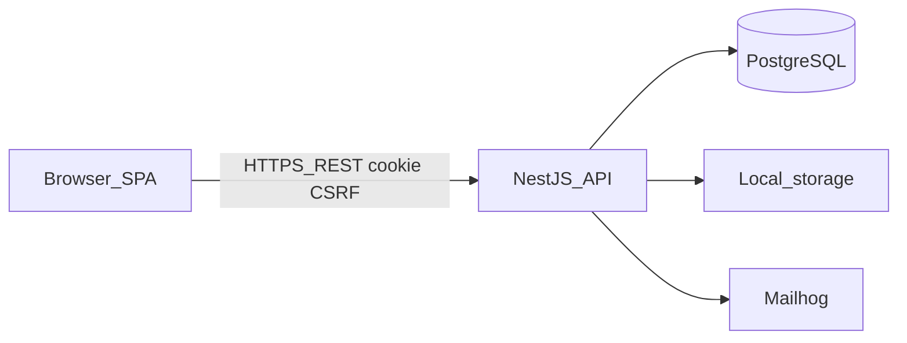

# High School Students' App — etapa 2 (interfață web)

> Continuare a planului MVP. Backend-ul REST din etapa 1 rămâne sursa de adevăr pentru securitate. Interfața din [PLAN_APLICATIE.md](PLAN_APLICATIE.md) §12 nu aplică reguli de acces; doar le reflectă.

**Obiectiv etapa 2:** aplicație web funcțională pentru ADMIN / TEACHER / STUDENT: login, invitații, grupuri, anunțuri, teme, teste, materiale, notificări, evenimente, calendar, profil. Plus golurile de API rămase din etapa 1, necesare acestor ecrane.

**Nu se schimbă stiva backend:** NestJS, PostgreSQL, Prisma, sesiuni cookie. Frontend recomandat: **React 19 + Vite + TypeScript + React Router** în `web/`. Next.js sau un BFF ar complica cookie-urile și CSRF fără câștig pentru un client pe același domeniu de dezvoltare. Fără servicii plătite (fără Vercel Pro, Auth0, S3).

---

## 1. Contradicții și decizii blocate

Păstrate din [docs/MVP_DECISIONS.md](docs/MVP_DECISIONS.md), plus:

- **SPA, nu SSR.** Cookie `HttpOnly` + `credentials: 'include'` + header `X-Requested-With: XMLHttpRequest` pe mutații (deja cerut de [src/common/guards/csrf.guard.ts](src/common/guards/csrf.guard.ts)).
- **Rolul dictează navigarea, nu securitatea.** Butoanele se ascund după `user.role` / `canPost`; fiecare acțiune trece tot prin API.
- **Înregistrare doar cu token de invitație** (query `?token=` pe `/register`).
- **Verify / reset** din linkul de email (`?token=`). Tokenul nu se loghează.
- **Fără predare de fișiere de către elev.** Doar progres personal.
- **PATCH grup** lipsește față de [PLAN_APLICATIE.md](PLAN_APLICATIE.md) (`PATCH /api/v1/groups/:id`). Se adaugă în API înainte de UI.
- **Interfață mobilă nativă:** în afara etapei 2 (layout responsive da).
- **Pilot producție (backup/monitoring):** tot etapa 12, nu acum.

---

## 2. Arhitectură



- `web/` vorbește doar cu `/api/v1`.
- Client HTTP unic: `fetch` wrapper (`apiClient`) cu cookie, CSRF, mapare 401 → logout, 404/403 → mesaje sigure (fără a dezvălui existența resurselor altui liceu).
- Vite proxy în development: `/api` → `http://localhost:3000`, ca să nu depindem de CORS în local. În `.env` backend, `CORS_ORIGINS` include și `http://localhost:5173` pentru cazul fără proxy.
- Stare auth: React context (`AuthProvider`) din `GET /auth/me` la boot.

---

## 3. Structura folderelor

Repo-ul rămâne aplicația Nest în rădăcină. Frontend separat, fără monorepo Nx.

```
apl-lic/
  src/                 # backend existent
  web/
    src/
      main.tsx
      app/             # router, layout, guards
      api/             # client HTTP, tipuri
      auth/
      groups/
      announcements/
      assignments/
      exams/
      materials/
      notifications/
      events/
      calendar/
      profile/
      admin/           # clase, materii, invitații (ADMIN/TEACHER)
      common/          # UI kit mic, formate date
    index.html
    vite.config.ts
  prisma/
  test/                # e2e API existente
  docs/MVP_DECISIONS.md
```

Fiecare ecran: pagină + hook de date. Fișiere sub 500 linii. Fără store global (Redux/Zustand) în MVP UI — context auth + hook-uri.

---

## 4. Schema bazei de date

**Nicio entitate nouă.** Se reutilizează modelele Prisma din etapa 1.

Singura schimbare de API (nu de tabel): `PATCH /api/v1/groups/:id` cu `{ name }` — profesorul grupului sau ADMIN, scoped pe `schoolId`. Opțional `teacherId` doar pentru ADMIN.

Relațiile rămân: School → User/Class/Subject/Group → conținut. UI-ul nu citește alt liceu; un 404 de la API se afișează ca „nu există”.

---

## 5. Strategie de autentificare (client)

Aliniată la [src/auth/auth.service.ts](src/auth/auth.service.ts):

- Login: `POST /auth/login` → cookie setat de server.
- Boot: `GET /auth/me`; 401 → rute publice.
- Logout: `POST /auth/logout` + redirect `/login`.
- Register: formular (parolă, nume) + token din URL; `role`/`schoolId` nu se trimit (sau se ignoră pe server, deja).
- Verify / forgot / reset: pagini publice; mesaj generic la forgot-password (anti-enumerare).
- Tokenul de sesiune nu ajunge în `localStorage`.

---

## 6. Strategie de autorizare (UI)

| Rol | Ecrane principale |
| ADMIN | structură școală (clase, materii, invitații, evenimente), audit read, aceleași grupuri |
| TEACHER | grupurile predare, anunțuri/teme/teste/materiale, `canPost` pe membri, invitații STUDENT |
| STUDENT | grupuri membre, citire, progres teme, postare anunț dacă `canPost` |

`RequireAuth` + `RequireRole` pe rute. Lipsa `canPost` ascunde formularul de anunț; POST rămâne protejat de API (403).

---

## 7. Plan de testare

- **API (Jest, deja):** se completează golurile: verify-email, forgot/reset, logout, PATCH grup, GET audit, enumerare email.
- **Unit web (Vitest):** `apiClient` (401, CSRF header), formatare erori.
- **E2e UI (Playwright, gratuit):** login valid/invalid; elev fără `canPost` nu publică; elev cu permisiune publică; calendar; download material eșuat pentru alt liceu (UI arată absență, nu date).

Nu se raportează passed fără rulare. Backend e2e rămân obligatorii după orice schimbare de API.

---

## 8. Ordinea etapelor de implementare

Nu se construiesc toate ecranele odată.

1. **API gaps** — `PATCH /groups/:id`; e2e verify/reset/logout/audit; seed de dezvoltare fără parolă în git ([prisma/seed.ts](prisma/seed.ts) citește env, sare dacă nu e `NODE_ENV=development`).
2. **Scaffold web** — Vite, TS strict, proxy, layout, `apiClient`, `AuthProvider`.
3. **Auth UI** — login, register-cu-invitație, forgot/reset/verify, logout, profil.
4. **Shell + home** — navigare pe rol, lista grupurilor, notificări badge.
5. **Grup** — detalii, membri, `canPost` (profesor).
6. **Anunțuri** — listă, pin, creare/editare după permisiune.
7. **Teme** — listă, detaliu, progres elev, creare profesor.
8. **Teste (examene)** — listă/detaliu, anulare profesor.
9. **Materiale** — listă, upload profesor, download autorizat.
10. **Evenimente + calendar** — vizualizare lună/săptămână pe baza `from`/`to` din API.
11. **Admin școală** — clase, materii, invitații; evenimente ADMIN.
12. **Playwright + duritate UI** — fluxuri pe rol, fără a trata UI-ul ca autoritate.

**Prima țintă după aprobare:** etapa 1 din această listă (API gaps + seed), apoi scaffold web — analog „configurarea proiectului” din planul 1.

---

## 9. Comenzi

```bash
# backend (neschimbat, Postgres pe 5433)
docker compose up -d
npm install
npx prisma migrate dev
npm run start:dev

# seed dezvoltare (fără admin hardcodat în repo)
npm run prisma:seed

# frontend
cd web
npm install
npm run dev
# http://localhost:5173

cd web && npm test
cd web && npm run test:e2e
```

`CORS_ORIGINS=http://localhost:5173,http://localhost:3000` în [.env.example](.env.example).

---

## 10. Riscuri

- **XSS + cookie:** cookie HttpOnly; fără `dangerouslySetInnerHTML` pe conținutul anunțurilor (text escape).
- **CSRF:** header obligatoriu pe mutații; omisiunea lui = 403 vizibil în UI.
- **IDOR:** UI nu construiește URL-uri către alt liceu; dacă totuși o face, API 404.
- **Token invitație/reset în URL:** nu se trimite la analytics; se scoate din history după submit unde e posibil.
- **Upload:** validare dublă (tip/mărime) în UI pentru UX; respingerea reală rămâne pe server.
- **CORS greșit:** proxy Vite în dev; origini explicite în prod.
- **Fără secrete în frontend:** niciun `SESSION_SECRET` în `web/`.

---

## Prima etapă concretă (după aprobare)

**Scop:** API-ul acoperă rutele din planul original încă lipsă; testele e2e auth/audit trec; `web/` pornește gol, cu health check către backend.

**Se modifică/creează:**
- [src/groups/groups.controller.ts](src/groups/groups.controller.ts) / [groups.service.ts](src/groups/groups.service.ts) — `PATCH :id`
- [test/auth.e2e-spec.ts](test/auth.e2e-spec.ts) — logout, verify, forgot/reset, mesaj identic la email necunoscut
- test e2e audit
- `prisma/seed.ts` + script npm (date doar dacă env de dezvoltare e setat)
- `web/` Vite + TypeScript + proxy `/api`
- CORS în [.env.example](.env.example)

**Nu în prima felie:** toate ecranele din §12, Playwright complet, producție.
