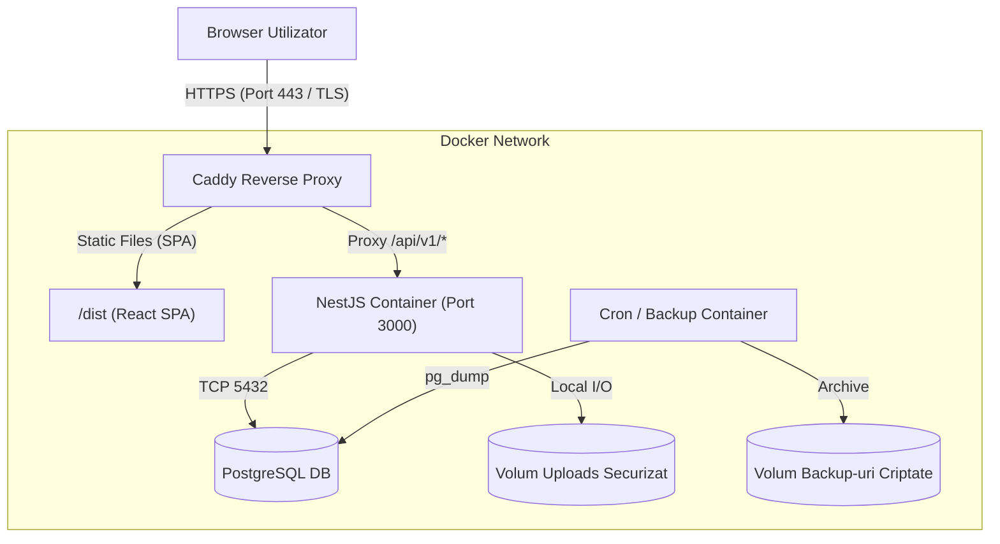

# High School Students' App — etapa 3 (Pilot, Securitate Producție și Observabilitate)

> Continuare a planurilor MVP (Etapa 1: Backend REST) și UI (Etapa 2: Web SPA). Răspunde direct la cerințele din [PLAN_APLICATIE.md](PLAN_APLICATIE.md) §10 (Etapa 12: Lansare pilot), §14 (Criterii de acceptare pentru MVP) și §16 (Decizii înainte de producție).

**Obiectiv etapa 3:** Transformarea aplicației dintr-un mediu local de dezvoltare într-un produs containerizat, rezilient, securizat și pregătit pentru un pilot într-un liceu real:
1. Pachet unificat de producție (Backend NestJS compilat + Frontend Vite distribuit static prin reverse proxy securizat cu TLS).
2. Sistem automat de backup și restaurare pentru baza de date PostgreSQL.
3. Testare automată E2E browser-level (Playwright) pe fluxurile fiecărui rol (`ADMIN`, `TEACHER`, `STUDENT`).
4. Observabilitate, healthchecks avansate (`/health/readiness`, `/health/liveness`) și logging de producție.
5. Consolidare securitate: protecție avansată la upload (magic bytes inspection), Content Security Policy (CSP) și rate limiting distribuit.

**Nu se schimbă stiva de bază:** NestJS, PostgreSQL, Prisma, React 19 + Vite. Nu se introduc servicii cloud costisitoare sau dependente de furnizor (vendor lock-in) — soluția rămâne hostabilă pe orice server Linux / VPS standard.

---

## 1. Decizii de arhitectură pentru pilot

- **Arhitectură containerizată unificată:**
  - `web/` este compilat în assets statice HTML/JS/CSS (`npm run build`).
  - Un container de reverse proxy ușor (**Caddy** sau **Nginx Alpine**) servește frontend-ul static și redirecționează apelurile `/api/*` către containerul NestJS. Caddy este recomandat pentru generarea automată a certificatelor Let's Encrypt / HTTPS fără configurări manuale de certbot.
  - Containerul NestJS rulează cu utilizator non-root (`node`).
- **Strategie de Backup & Disaster Recovery:**
  - Script cron/systemd sau container de backup care rulează `pg_dump` zilnic într-un volum montat separat sau stocare securizată.
  - Script de verificare a integrității backup-ului (`scripts/restore-check.sh`).
- **Validare avansată materiale (Upload Security):**
  - Verificare mime-type real bazat pe magic numbers/semnătură binară (ex. `file-type`), nu doar pe extensia trimisă de browser.
  - Salvare pe disc fără drepturi de execuție și servire doar cu antete `Content-Disposition: attachment` și `X-Content-Type-Options: nosniff`.
- **E2E Browser Testing:**
  - Suită completă Playwright rulată împotriva mediului de test local sau containerizat.

---

## 2. Arhitectura mediului de producție / pilot



---

## 3. Structura componentelor noi

```
apl-lic/
  docker/
    Dockerfile.backend         # Multi-stage Docker build pentru NestJS
    Dockerfile.frontend        # Multi-stage build pentru React SPA
    Caddyfile                  # Configurare Caddy (HTTPS + SPA fallback + API proxy + CSP)
  docker-compose.prod.yml      # Orchetrare producție: Caddy, NestJS, Postgres, Backup
  scripts/
    backup-db.sh               # Script pg_dump comprimat și rotit (reținere 14 zile)
    restore-db.sh              # Script automat de restore și validare
    health-check.sh            # Script de monitorizare pentru systemd/uptime kuma
  web/
    playwright.config.ts       # Configurare Playwright
    tests/e2e/
      auth.spec.ts             # Login, invitație, verificare email, reset parolă
      teacher-flow.spec.ts     # Creare temă, test, încărcare material didactic, permisiune canPost
      student-flow.spec.ts     # Consultare materiale, marcare progres temă, postare permisă/blocată
      admin-flow.spec.ts       # Configurare clasă, materie, emitere invitație, citire audit
  src/
    common/
      health/                  # Health indicatori avansați (DB ping, storage write/read, memorie)
      pipes/file-validation.pipe.ts  # Magic-bytes verification pentru fișiere încărcate
```

---

## 4. Securitate și Hardening

1. **Content Security Policy (CSP):**
   - Configurat în reverse-proxy: `default-src 'self'; script-src 'self'; style-src 'self' 'unsafe-inline'; object-src 'none'; base-uri 'self'`.
2. **Anti-Tampering Fișiere:**
   - Scanare magic numbers pe fișierele trimise la `POST /api/v1/groups/:id/materials` (PDF, imagini, zip, documente Office permise).
   - Dimensiunea maximă impusă strict la nivel de reverse proxy (Caddy `request_body max_size 10MB`) și la nivel de NestJS (`MulterOptions`).
3. **Izolarea drepturilor pe disc:**
   - Containerul de backend rulează ca utilizator ne-privilegiat (`USER node`).
   - Volumul de storage nu are drepturi de execuție scripturi (`noexec` la montare).
4. **Cookie Security în Producție:**
   - `COOKIE_SECURE=true` obligatoriu.
   - `SameSite=Lax`, `HttpOnly=true`, prefix `__Host-` sau securitate pe domeniu complet.

---

## 5. Strategia de Testare E2E (Playwright pe roluri)

Testele Playwright vor rula fără intervenție manuală împotriva unui server de test configurat automat:

| Scenariu | Pași de testat |
| :--- | :--- |
| **Flux Invitare & Înregistrare** | 1. Admin invită un student -> 2. Se extrage tokenul -> 3. Student navighează pe `/register?token=...` -> 4. Completează parola -> 5. Se autentifică cu succes. |
| **Flux Didactic Profesor** | 1. Profesor intră în grup -> 2. Postează temă și test -> 3. Încarcă fișier PDF -> 4. Activează permisiunea `canPost` unui elev. |
| **Flux Elev & Restricții** | 1. Elev fără permisiune vede că nu are buton/formular de anunț -> 2. După activare de către profesor, publică anunț -> 3. Elevul bifează progresul temei (TODO -> COMPLETED). |
| **Izolare Multi-Tenant** | 1. Elevul din Liceul B încearcă să navigheze direct pe URL-ul grupului din Liceul A -> 2. Primește ecran de 404/Negăsit (fără leak de date). |

---

## 6. Ordinea etapelor de implementare

1. **Securizare Backend & Uploads:**
   - Adăugare validare MIME reală (magic bytes) pentru `materials`.
   - Healthcheck detaliat cu `@nestjs/terminus` sau verificări native pe DB și disc (`/api/v1/health/readiness`, `/api/v1/health/liveness`).
2. **Containerizare & Producție (Docker + Caddy):**
   - Creare `Dockerfile.backend` (multi-stage: build -> prune -> runner minimal).
   - Creare `Dockerfile.frontend` (compilare Vite -> export `dist`).
   - Configurare `Caddyfile` cu reguli de rutare, gzip/zstd compression, antete de securitate (CSP, HSTS) și proxying.
   - Configurare `docker-compose.prod.yml`.
3. **Backup & Mentenanță:**
   - Script `backup-db.sh` cu rotație automată și criptare opțională.
   - Script `restore-db.sh` pentru simulare automată de restaurare.
4. **Automatizare Teste E2E (Playwright):**
   - Inițializare Playwright în `web/`.
   - Implementare teste pe cele 3 roluri (`ADMIN`, `TEACHER`, `STUDENT`).
   - Script unificat în root `npm run test:e2e:ui`.
5. **Ghid de Lansare Pilot & Documentație de Operare:**
   - Document `docs/PILOT_RUNBOOK.md`: pași de instalare pe server curat, configurare DNS/domeniu, pornire containere, primul admin (`bootstrap:admin`) și procedură de urgență.

---

## 7. Criterii de finalizare (Definition of Done)

- [ ] `docker compose -f docker-compose.prod.yml up` pornește complet sistemul (Postgres + NestJS + Caddy).
- [ ] Frontend-ul SPA este servit securizat, iar rutele de API răspund corect în spatele reverse proxy-ului.
- [ ] Testele E2E Playwright trec 100% pe toate fluxurile de utilizator.
- [ ] Scriptul de backup generează o arhivă validă a bazei de date și scriptul de restore o restaurează complet.
- [ ] Testele backend existente (unitare și e2e) rămân complet verzi.
- [ ] Există runbook clar și concis pentru administratorul de sistem al liceului.

