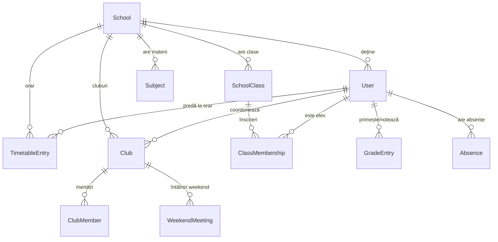

# Raport Tehnic Exhaustiv: Starea Curentă a Aplicației HSSA (High School Students App)

*Data generării raportului:* 8 Noiembrie 2026  
*Versiune arhitecturală:* Producție v0.2.0 (NestJS + React / Vite + PostgreSQL / Prisma)  
*Status build:* Backend TypeScript: **PASS (0 erori)** | Frontend Vite: **PASS (0 erori)**

---

## 1. Rezumat Executiv & Domeniu de Aplicabilitate

Platforma **HSSA (High School Students App)** este o soluție software integrată de management educațional, digitalizare școlară și comunicare academică destinată unităților de învățământ preuniversitar (licee, colegii). Aplicația oferă o arhitectură multi-rol strict securizată (**Elev**, **Profesor**, **Administrator**), unificând activitățile didactice clasice (catalog electronic, evidență absențe, orar modular) cu activitățile extracurriculare (cluburi de elevi, înscrieri Google Forms, activități de weekend).

Sistemul este distribuit în arhitectură decuplată:
- **Backend API:** NestJS 11+ rulat pe infrastructura cloud Render, cu persistență pe bază de date relațională PostgreSQL gestionată prin Prisma ORM.
- **Frontend SPA:** Single Page Application construită cu React 18, TypeScript și Vite, găzduită pe Vercel, optimizată pentru timpi de încărcare sub-secundă și consum redus de date.

---

## 2. Arhitectura Bazei de Date & Relațiile Cheie (Prisma ORM)

Baza de date este organizată în jurul entității centrale `School`, asigurând izolarea pe școală a fiecărui set de date (multi-tenant logic).



### Enumerări de Sistem (Enums)
- **`UserRole`**: `ADMIN`, `TEACHER`, `STUDENT`.
- **`DayOfWeek`**: `MONDAY`, `TUESDAY`, `WEDNESDAY`, `THURSDAY`, `FRIDAY`, `SATURDAY`, `SUNDAY`.
- **`GradeType`**: `ORAL`, `TEST`, `HOMEWORK`, `PROJECT`, `THESIS`.
- **`GradeStatus`**: `ACTIVE`, `VOIDED`.
- **`AbsenceStatus`**: `UNEXCUSED`, `EXCUSED`.
- **`TermStatus`**: `OPEN`, `CLOSED`.

### Modele Relaționale Principale
1. **`SchoolClass` & `ClassMembership`:**
   - Definește clasele (ex: „10-B”, an școlar 2026-2027).
   - `ClassMembership` leagă elevii de o clasă printr-o cheie unică compusă `[studentId, classId]`.
2. **`TimetableEntry`:**
   - Definește orarul formal de cursuri Luni - Vineri.
   - Legat de `SchoolClass`, `Subject` și `User` (profesorul cu rolul dedicat `TimetableTeacher`).
   - Conține `period` (1-20), `startTime` ("HH:mm"), `endTime` ("HH:mm") și `room`.
   - Index unice: `@@unique([classId, dayOfWeek, period])`.
3. **`Club`, `ClubMember` & `WeekendMeeting`:**
   - `Club`: Inițiat de orice utilizator (elev coordonator, profesor sau admin). Deține `formsUrl` (link extern Google Forms pentru formulare oficiale).
   - `ClubMember`: Membrii înscriși în club.
   - `WeekendMeeting`: Activități de weekend (Sâmbătă/Duminică) de durată variabilă (ex: 10:00 - 13:30) afișate în orar.
4. **`GradeEntry` & `Absence`:**
   - Legate de modul/trimestru (`Term`), elev, profesor și grup de materie (`SubjectGroup`).
   - Audit trail integrat pentru anularea notelor și motivarea absențelor cu motiv înregistrat.

---

## 3. Securitate, Permisiuni & Matricea de Acces

Aplicația implementează principiul **Least Privilege** pe ambele straturi:

| Endpoint / Resursă | STUDENT (Elev) | TEACHER (Profesor) | ADMIN (Director / Secretar) |
|---|---|---|---|
| `GET /api/v1/users` | ❌ Acces Refuzat (403) | ✅ Permis (Listă elevi/prof.) | ✅ Permis (Complet) |
| `GET /api/v1/classes/:id` | ❌ Doar orarul clasei lui | ✅ Vede efectivul de elevi | ✅ Vede și modifică efectivul |
| `POST /api/v1/classes/:id/students` | ❌ Acces Refuzat (403) | ✅ Înscrie elevi în clasă | ✅ Înscrie elevi în clasă |
| `DELETE /api/v1/classes/:id/students/:id` | ❌ Acces Refuzat (403) | ✅ Elimină din clasă | ✅ Elimină din clasă |
| `GET /api/v1/timetable/me` | ✅ Vede orarul clasei lui | ✅ Vede orele predate de el | ✅ Vede orarul global |
| `POST /api/v1/timetable` | ❌ Acces Refuzat (403) | ❌ Acces Refuzat (403) | ✅ Configurează orarul |
| `GET /api/v1/clubs/weekend-schedule` | ✅ Vede activitățile cluburilor | ⚠️ **Izolare:** Doar dacă e coordonator/membru | ✅ Vede toate activitățile |
| `POST /api/v1/clubs/:id/meetings` | ⚠️ Doar dacă e coordonatorul clubului | ⚠️ Doar dacă e coordonator | ✅ Permis |
| `POST /api/v1/grades` | ❌ Acces Refuzat (403) | ✅ Notează la materia proprie | ✅ Permis |
| `DELETE /api/v1/grades/:id` | ❌ Acces Refuzat (403) | ✅ Anulează notă cu motiv | ✅ Permis |

### Mecanism de Autentificare
- Sesiuni cu cookie-uri securizate `HttpOnly`, `SameSite=None`, `Secure=true`, compatibile cu cereri cross-origin între Vercel (`https://apl-lic.vercel.app`) și Render.
- Protecție CSRF activată prin `CsrfGuard`.
- Politică strictă de CORS configurabilă din variabila `CORS_ORIGINS`.

---

## 4. Detalierea Modulelor Funcționale Frontend

### 4.1. Modulul Orar Școlar (`web/src/timetable/TimetableView.tsx`)
- **Grid Săptămânal Dinamic:** Afișează de la Luni până Duminică (7 coloane).
- **Format 24 de Ore:** Nicio urmă de AM/PM. Orele de după-amiază sunt etichetate clar (ex: `13:00 - 13:50`, `18:00 - 18:50`).
- **Selectorul Tastabil Inteligent (`TimeInput24.tsx`):**
  - O singură casetă unificată `HH : MM`.
  - Tastarea cifrelor `3-9` completează automat `03..09` și mută focusul instantaneu la minut.
  - Tastarea cifrei `8` devine `08` și trece automat la minut.
  - Tastarea cifrelor `1` sau `2` permite introducerea cifrei unităților (pentru orele `10-23`). Dacă utilizatorul dă click sau apasă săgeată dreapta, se lasă `01`/`02`.
  - După completarea minutelor, cursorul sare automat la caseta orei de sfârșit.
- **Sloturi Orare Flexibile & Schimburi:**
  - Preseturile rapide: *Cursuri de Dimineață* (08:00 - 14:50) și *Cursuri de După-amiază* (13:00 - 19:50).
  - Adăugare de rânduri personalizate cu orice interval (de la `07:30` până la `20:30`).
- **Weekend Integrat:**
  - Coloanele Sâmbătă și Duminică găzduiesc întâlnirile de club de lungă durată (ex: `10:00 - 13:30`).
  - Buton dedicat `+ Club` pe chenar pentru coordonatori.
  - Profesorii simpli au coloanele de weekend ascunse din interfață pentru confidențialitatea activităților elevilor.

### 4.2. Modulul Cluburi & Activități (`web/src/clubs/ClubsView.tsx`)
- Înființare cluburi noi de către elevi, profesori sau administratori.
- Câmp dedicat pentru link Google Forms (`formsUrl`) cu buton de deschidere în tab nou.
- Înscriere directă din platformă (`Alătură-te`) sau părăsire club (`Părăsește`).
- Programare întâlniri de weekend asociate clubului coordonat.

### 4.3. Modulul Catalog & Situație Școlară (`web/src/catalog/CatalogView.tsx`)
- **Selector Dual:** Permite profesorului/adminului filtrarea după un elev specific (fișă matricolă individuală) sau vizualizarea colectivă a materiei.
- **Note Oficiale:**
  - Calcul automat al mediei curente.
  - Badge-uri colorate în funcție de notă ($\ge 5$ albastru, $< 5$ roșu).
  - Posibilitate de anulare motivată a notei.
- **Absențe pe Materii:**
  - Fiecare absență conține obligatoriu materia la care a fost înregistrată.
  - Contor separat pentru *Absențe Nemotivate* vs *Absențe Motivate*.
  - Buton de motivare instantă cu introducerea motivului scutirii.
- **Export & Print:** Buton dedicat `Printează` configurat cu CSS de paginare curată.

### 4.4. Modulul Clase & Elevi (`web/src/classes/ClassesView.tsx`)
- Carduri informative pentru fiecare clasă.
- Panou modal detaliat cu efectivul de elevi:
  - Căutare și selectare elevi neasignați dintr-un dropdown.
  - Înscriere rapidă în clasă (`POST /api/v1/classes/:id/students`).
  - Eliminare elev din clasă (`DELETE /api/v1/classes/:id/students/:studentId`).

### 4.5. Modulul Teste & Examene (`web/src/exams/ExamsView.tsx`)
- Programare teze, lucrări de control și examene pentru fiecare materie/grup.
- Integrare bidirecțională cu Calendarul școlar general (`CalendarView.tsx`).

### 4.6. Sistemul de Teme & UX: Dark Mode & Modularitate Asset-uri
- **Dark Mode:**
  - Buton toggle poziționat la baza meniului lateral (cu indicator ON / OFF și pictograme Soare/Lună).
  - Stocare în `localStorage` (`hssa_theme`).
  - Variabile CSS custom în `index.css` sub `[data-theme='dark']` fără flashing la reîncărcare.
- **Scroll Bar Independent:**
  - Sidebar-ul are înălțime fixă `100vh` (`position: sticky`), iar meniul intern folosește `.custom-scrollbar` pe axa Y.
  - Scroll-ul paginii principale nu afectează vizibilitatea meniului.
- **Modularitate Asset-uri PNG (`AssetIcon.tsx`):**
  - Orice pictogramă din platformă verifică registrul `ASSET_REGISTRY`. Când se adaugă fișiere `.png` în `src/assets/icons/`, acestea înlocuiesc automat pictogramele vectoriale Lucide, fără a necesita rescrierea componentelor.

---

## 5. Ghid de Rulare, Testare și Deployment

### Rulare Locală (Development)
```bash
# Backend
npm install
npx prisma generate
npx prisma migrate dev
npm run start:dev

# Frontend
cd web
npm install
npm run dev
```

### Comenzi de Verificare a Integrității
```bash
# Verificare tipuri backend (fără erori TypeScript)
npx tsc --noEmit

# Compilare bundle frontend pentru producție
npm run build --prefix web
```

### Deployment
- **Backend (Render):** La push pe branch-ul `main`, Render declanșează `npm run build` (`npx prisma generate && npx prisma migrate deploy && tsc`) urmat de `npm run start:prod`.
- **Frontend (Vercel):** La push pe `main`, Vercel preia automat directorul `web`, rulează `vite build` și distribuie noile asset-uri pe CDN-ul global.

---

## 6. Concluzie

Aplicația HSSA a atins un nivel avansat de maturitate funcțională și arhitecturală:
1. Toate fluxurile școlare (clase, materii, catalog, orar flexibil) sunt sincronizate cu baza de date.
2. Weekend-ul este integrat organic pentru activități de club, respectând bariera de confidențialitate între profesori și elevi.
3. Interfața cu utilizatorul este rapidă, accesibilă în format 24h, adaptată pentru mod întunecat și pregătită pentru viitoare asset-uri grafice.

