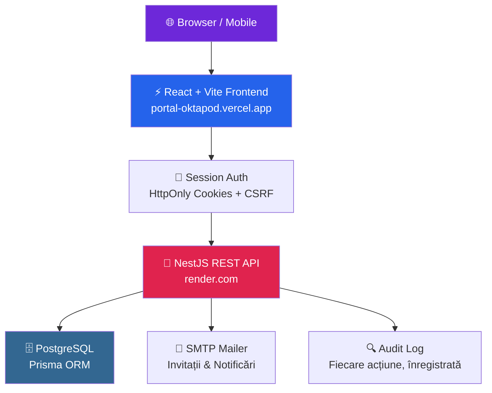

<div align="center">


# 🐙 Oktapod

### **Platforma digitală care transformă liceul tău în secolul XXI**

[](https://portal-oktapod.vercel.app)
[](https://nestjs.com)
[](https://react.dev)
[](https://postgresql.org)
[](#)

---

> *„Dacă un profesor ar putea vedea situația fiecărui elev în timp real, nota medie în România ar crește cu 10%."*  
> — O idee care ne-a ținut treji la 2 noaptea.

---

</div>

## ✨ De ce Oktapod?

Liceele din România se confruntă zilnic cu același coșmar: cataloage pe hârtie, carnete pierdute, părinți care nu știu ce note au copiii și profesori care petrec ore întregi cu birocrație în loc să predea. **Oktapod rezolvă toate astea.**

<div align="center">

```
╔═══════════════════════════════════════════════════════════════╗
║                                                               ║
║   📚 Catalog digital    📅 Orar inteligent    🏆 Examene     ║
║   👨‍🏫 Profesori          👩‍🎓 Elevi              👨‍👩‍👧 Părinți    ║
║   📊 Statistici         💬 Mesagerie          🎭 Cluburi     ║
║                                                               ║
╚═══════════════════════════════════════════════════════════════╝
```

</div>

---

## 🎯 Ce face Oktapod în 60 de secunde

| 👨‍🏫 Ca profesor... | 👩‍🎓 Ca elev... | 🔧 Ca administrator... |
|---|---|---|
| Dai o notă în 3 click-uri | Vezi notele în timp real | Gestionezi toată școala dintr-un dashboard |
| Programezi un test cu notificare automată | Primești alertă când apare o notă nouă | Adaugi clase, materii, profesori instant |
| Motivezi absențe cu un buton | Descarci situația școlară PDF | Auditezi orice acțiune din platformă |
| Trimiți mesaje elevilor și părinților | Vorbești cu profesorii direct | Transferi elevi între clase cu drag & drop |

---

## 🖼️ Galerie

<div align="center">

### 📊 Catalog Electronic — vizualizare per elev, per clasă, per materie
*Note, medii, absențe — totul într-un singur loc, în timp real*

---

### 🗓️ Orar Inteligent
*Generat automat. Actualizat instant. Accesibil de pe orice dispozitiv.*

---

### 🏆 Teste & Examene
*Programează un test, toată clasa e notificată automat. Zero uitări.*

---

### 🎭 Cluburi Școlare
*De la TED-Ed la Teatru — fiecare activitate extracurriculară, organizată perfect.*

</div>

---

## 🏗️ Arhitectură



---

## 🔐 Securitate de nivel enterprise

```
✅  Argon2id password hashing          ✅  HttpOnly session cookies
✅  CSRF protection pe fiecare request  ✅  Rate limiting anti-brute-force  
✅  Invite-only registration            ✅  School-scoped authorization
✅  Audit log complet                   ✅  TLS automat prin Caddy
```

> **Zero date expuse.** Fiecare profesor vede doar elevii lui. Fiecare elev vede doar notele lui. Fiecare școală trăiește în propriul sandbox izolat.

---

## ⚡ Tech Stack

<div align="center">

| Layer | Tehnologie | De ce? |
|-------|-----------|--------|
| 🎨 **Frontend** | React 18 + Vite + TypeScript | Rapid, modern, type-safe |
| 🚀 **Backend** | NestJS + TypeScript | Scalabil, decoratori, testabil |
| 🗄️ **Database** | PostgreSQL + Prisma ORM | ACID, migrații sigure |
| 🔐 **Auth** | Session cookies + Argon2id | Securitate maximă, fără JWT expus |
| 📧 **Mail** | Nodemailer + MailHog (dev) | Invitații și notificări |
| 🐳 **Infra** | Docker + Caddy | Deploy în 1 comandă, HTTPS automat |
| 🧪 **Testing** | Jest + Playwright | Unit + E2E, CI-ready |

</div>

---

## 🚀 Instalare rapidă (dezvoltatori)

### Cerințe
- Node.js 20+
- Docker Desktop
- npm

### Setup în 5 minute

```bash
# 1. Clonează repo-ul
git clone <repo-url> && cd apl-lic

# 2. Configurează variabilele de mediu
copy .env.example .env

# 3. Pornește baza de date
docker compose up -d

# 4. Instalează dependențele și migrează
npm install
npx prisma generate
npx prisma migrate dev

# 5. Pornește serverul
npm run start:dev
```

| Serviciu | URL |
|----------|-----|
| 🚀 API | http://localhost:3000/api/v1/health |
| 📖 Swagger | http://localhost:3000/api/docs |
| 📧 MailHog | http://localhost:8025 |

### Creează primul administrator

```bash
# Setează în .env:
# BOOTSTRAP_ADMIN_EMAIL=director@liceu.ro
# BOOTSTRAP_ADMIN_PASSWORD=parola-sigura
# BOOTSTRAP_SCHOOL_NAME="Liceul Meu"

npm run bootstrap:admin
```

---

## 🧪 Teste

```bash
# Unit tests
npm test

# End-to-end (backend)
npm run test:e2e

# Browser tests (Playwright)
cd web && npm run test:e2e:install   # o singură dată — descarcă Chromium
cd .. && npm run test:e2e:ui
```

---

## 🌍 Deployment producție

```bash
cp .env.prod.example .env.prod
# → Completează fiecare variabilă

docker compose --env-file .env.prod -f docker-compose.prod.yml up -d --build
```

Includem: **PostgreSQL** + **NestJS** + **Caddy** (HTTPS automat) + **backup-uri programate**.

Documentație completă → [`docs/PILOT_RUNBOOK.md`](docs/PILOT_RUNBOOK.md)

### Variabile cheie pentru producție

| Variabilă | Rol |
|-----------|-----|
| `TRUST_PROXY` | Nr. de proxy-uri de încredere (1 în spatele Caddy) |
| `ENABLE_SWAGGER` | Dezactivat automat în producție |
| `COOKIE_SECURE=true` | Obligatoriu în producție |
| `LOG_LEVEL` | Nivel log Pino JSON |
| `MAIL_USER` / `MAIL_PASSWORD` | Autentificare SMTP |

### Health checks

```
GET /api/v1/health/liveness    → Este procesul viu?
GET /api/v1/health/readiness   → Poate primi trafic?
GET /api/v1/health/metrics     → Metrici Prometheus (blocat de proxy)
```

---

## 🗺️ Roadmap

```
✅ v0.1  Catalog electronic + note + absențe
✅ v0.2  Mesagerie internă + cluburi + examene
✅ v0.3  Orar generat automat + diriginție
🔄 v0.4  App mobil (React Native)
🔄 v0.5  Notificări push + integrare Google Calendar
🔄 v1.0  Multi-școală · Analytics pentru inspectorate
```

---

## 💜 De ce ar trebui liceul tău să adopte Oktapod?

<div align="center">

```
┌─────────────────────────────────────────────────────────────┐
│                                                             │
│   📉 Fără hârtie    📡 Acces de oriunde    ⏱️ Timp câștigat │
│                                                             │
│   Un profesor economisește ~3 ore/săptămână                 │
│   Un director are rapoarte instant, nu după 2 zile          │
│   Un elev știe imediat ce notă a luat                       │
│   Un părinte nu mai sună la secretariat                     │
│                                                             │
│         🐙  Oktapod — școala care respiră digital           │
│                                                             │
└─────────────────────────────────────────────────────────────┘
```

</div>

---

<div align="center">

**Construit cu 💜 de o echipă care crede că educația merită software de calitate**

[](https://portal-oktapod.vercel.app)

*Vrei să implementezi Oktapod la liceul tău? Scrie-ne.*

</div>
